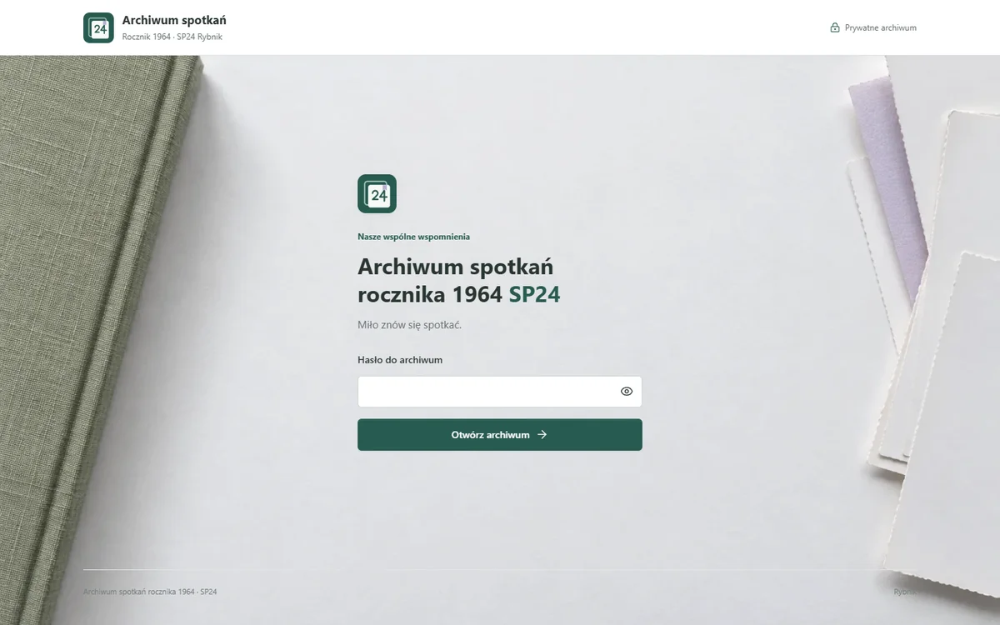

  
  <h1>Archiwum spotkań</h1>
  
<strong>Rocznik 1964 · SP24 · Rybnik</strong>

  
Wspólne wspomnienia. Osobne albumy. Jedno miejsce na zdjęcia i filmy.

  
<a href="#szybki-start">Uruchomienie</a> · <a href="DOKUMENTACJA.md">Dokumentacja</a> · <a href="HOSTING.md">Hosting</a> · <a href="#bezpieczeństwo">Bezpieczeństwo</a>

Prywatna aplikacja do przeglądania fotografii i nagrań z przeszłych i przyszłych spotkań. Każde spotkanie ma własny album, a wspólna galeria łączy wszystkie lata. Projekt rozdziela publiczny kod od prywatnych materiałów uczestników.

| Status | Informacja |
| --- | --- |
| Podgląd lokalny | [127.0.0.1:8000](http://127.0.0.1:8000), po uruchomieniu serwera |
| Wdrożenie online | Jeszcze niepotwierdzone; adres lokalny nie jest publicznym demo |
| Repozytorium | [wojtekp2002/EventPhotoGallery](https://github.com/wojtekp2002/EventPhotoGallery) |
| Media uczestników | Nie są dołączone do repozytorium |

Zrzut przedstawia wyłącznie ekran wejścia. Dekoracyjne tło nie jest fotografią szkoły ani uczestników.

## Funkcje

- Jasny, responsywny układ, albumy spotkań i wyszukiwarka.
- Pełnoekranowy podgląd, pokaz slajdów, obsługa klawiatury i gestów.
- Pobieranie oryginałów z miniatury oraz podglądu.
- Nagrania MP4 z odtwarzaniem, przewijaniem i pobieraniem.
- Dodawanie zdjęć do istniejącego lub nowego spotkania.
- Podgląd plików, postęp, zatrzymywanie i ponawianie przesyłania.
- Osobne hasło organizatora do dodawania materiałów.
- Prywatne media i sekrety poza repozytorium.

## Szybki start

Node.js 22+. Do lokalnego działania nie jest potrzebne instalowanie pakietów.

~~~sh
git clone https://github.com/wojtekp2002/EventPhotoGallery.git
cd EventPhotoGallery
npm run dev
~~~

Otwórz adres podany w terminalu. Domyślnie to `http://127.0.0.1:8000`; zajęty port jest zastępowany kolejnym.

Masz już projekt na dysku? Uruchom tylko `npm run dev` w jego folderze. Na Windows można również użyć `start-galeria.bat`.

| Lokalny podgląd | Hasło (nie do produkcji) |
| --- | --- |
| Archiwum | `SP24-2007` |
| Dodawanie zdjęć | `organizator-lokalnie` |

To jawne hasła wyłącznie lokalnego podglądu. W produkcji nie ma domyślnych haseł. Własne wartości można podać w ignorowanym pliku `.dev.vars`.

Po świeżym sklonowaniu archiwum będzie puste. To zamierzone: oryginały i katalog albumów pozostają poza Gitem. Pierwsze spotkanie można utworzyć przez panel dodawania zdjęć.

## Dodawanie zdjęć

1. Otwórz archiwum i wybierz **Dodaj zdjęcia**.
2. Podaj hasło organizatora.
3. Wybierz album albo **Nowe spotkanie** i wpisz jego nazwę. Data jest opcjonalna.
4. Wybierz zdjęcia i zatwierdź. Album aktualizuje się automatycznie.

JPG, PNG, WebP; do 20 MB na zdjęcie i 200 zdjęć w kolejce. Ponowienie przesłania tego samego pliku przez panel nie powiela go w albumie. Starsze pliki importowane ręcznie mogą mieć inne nazwy.

Filmy MP4 importuje się do magazynu z manifestem, nie przez formularz zdjęć. Szczegóły i polecenia importu są w [dokumentacji](DOKUMENTACJA.md#import-starszych-materiałów).

## Interfejs

- Tło z motywem papierowego albumu, z osobną kompozycją na telefon i komputer.
- Po zalogowaniu tło jest stonowane, aby fotografie pozostały najważniejsze.
- Stałe proporcje ikon, wyraźny fokus klawiatury i widoczne przyciski pobierania.
- Animacje respektują `prefers-reduced-motion`.
- Lokalne zasoby: bez zewnętrznych fontów, trackerów i usług potrzebnych do wyświetlenia interfejsu.

Tła WebP ważą około **91 KB** na komputerze i **37 KB** na telefonie. Przeglądarka dobiera odpowiedni wariant przez `<picture>`. [Pochodzenie grafik](docs/ASSETS.md).

## Architektura

HTML, CSS i JavaScript oraz jedno API oparte na Fetch/Web Crypto. Lokalny Node.js uruchamia ten sam handler co Cloudflare Pages Worker. Zmienia się jedynie adapter magazynu: lokalne pliki lub prywatne R2.

| Warstwa | Technologia / odpowiedzialność |
| --- | --- |
| Interfejs | HTML, CSS, JavaScript ES Modules, lokalne ikony Lucide |
| API | Fetch API, Web Crypto, sesja podpisana HMAC |
| Lokalny serwer | Node.js 22+, adapter plików, nasłuch tylko na loopback |
| Hosting przygotowany w kodzie | Cloudflare Pages Worker i prywatny bucket R2 |
| Testy | `node:test`, Playwright i Edge |

~~~text
Przeglądarka
    |
    +-- publiczny interfejs i grafiki
    |
    +-- API / autoryzacja
            |
            +-- katalog albumów i manifesty
            +-- oryginały zdjęć i zakresy plików MP4
            +-- zapis nowych albumów i zdjęć
                    |
                    +-- dysk lokalny albo prywatne R2
~~~

~~~text
deploy/
  index.html              interfejs
  styles.css              jeden zestaw stylów
  app.js                  albumy, podgląd, przesyłanie
  _worker.js              wspólne API i kontrola dostępu
  assets/                 znak archiwum, favicon i tła WebP
  vendor/                 ikony Lucide i licencja
server/local-storage.mjs   lokalny adapter magazynu
local-server.js           serwer developerski, tylko loopback
media/events/<album>/      prywatne pliki, poza Gitem
tests/                    testy HTTP i przeglądarkowe
docs/                     publiczny podgląd i pochodzenie grafik
~~~

Nie ma procesu budowania frontendu ani frameworka wymaganego do lokalnego uruchomienia.

## Bezpieczeństwo

| Mechanizm | Co zapewnia |
| --- | --- |
| Autoryzacja po stronie serwera | Bez sesji nie można pobrać prywatnych mediów ani manifestów |
| Osobna rola organizatora | Przeglądanie nie daje uprawnień do przesyłania plików |
| Cookie HttpOnly i SameSite | Sesja nie jest przechowywana w `localStorage`; w produkcji HTTPS ma też `Secure` |
| Kontrola Origin i walidacja przesyłania | Sprawdzenie źródła zapisu, rozmiaru i sygnatury zdjęcia |
| CSP i prywatny cache | Ograniczenie źródeł zasobów i `no-store` dla prywatnych odpowiedzi |
| ETag i nazwy oparte na zawartości | Ochrona równoległych zapisów manifestu i deduplikacja nowych plików |

**Granice ochrony:** wspólne hasło nie identyfikuje poszczególnych osób, a uprawniony widz może przekazać pobrany plik dalej. Lokalny limiter logowania nie zastępuje rozproszonej ochrony przed próbami logowania na hostingu. Przed publikacją trzeba ustawić własne sekrety oraz ograniczenia prób. [Pełny opis](DOKUMENTACJA.md#dostęp).

## Hosting

Kod jest przygotowany pod **Cloudflare Pages + prywatne R2**, lecz nie oznacza to wdrożenia ani aktywacji usługi. R2 wymaga subskrypcji i checkout, więc nie przedstawiamy go jako pewnej opcji bez karty. [Warunki uruchomienia R2](https://developers.cloudflare.com/r2/get-started/).

Wariant **Workers + Backblaze B2** jest opisanym kierunkiem bez karty, nie gotową integracją. Wymaga adaptera, sprawdzenia sposobu dostarczania filmów i pilnowania limitów. Porównanie, źródła oraz stan weryfikacji: [HOSTING.md](HOSTING.md).

Hasło w JavaScript i publiczny folder ze zdjęciami nie zastępują prywatnego magazynu. Sam push kodu na GitHub nie uruchamia API i nie przesyła mediów.

## Testy

~~~sh
npm test
~~~

Testy API kontrolują autoryzację, pobrane bajty i nazwy, uprawnienia organizatora, równoległe przesyłanie, duplikaty, zakresy nagrań MP4 oraz publiczne zasoby interfejsu. Pracują w katalogach tymczasowych i nie zmieniają archiwum uczestników.

Testy przeglądarkowe wymagają pakietu Playwright i Edge:
~~~sh
npm install --no-save playwright
node tests/browser.mjs
~~~

Dla Chromium ustaw `BROWSER_CHANNEL=chromium` i zainstaluj przeglądarkę przez `npx playwright install chromium`. Testy sprawdzają logowanie, pobieranie, przesyłanie, cztery szerokości ekranu, wybór tła i ograniczony ruch. Wyniki i lokalne zrzuty trafiają do ignorowanego `.artifacts/`.

## Przed publikacją

1. Uruchom testy i sprawdź `git status` oraz `git diff --cached --stat` po przygotowaniu zmian.
2. Upewnij się, że commit nie zawiera `media/`, `.dev.vars`, `.env`, `.artifacts/` ani innych prywatnych kopii zdjęć.
3. Nie publikuj zrzutów zalogowanej galerii z uczestnikami. Obraz w tym README pokazuje tylko publiczny ekran wejścia.
4. Sprawdź również historię repozytorium. `.gitignore` nie usuwa plików już zapisanych we wcześniejszych commitach.
5. Publiczny adres demo wpisz dopiero po wdrożeniu i sprawdzeniu dostępu bez zalogowania.

## Najczęstsze pytania

**Dlaczego po sklonowaniu nie ma zdjęć?** Oryginały są celowo wyłączone z repozytorium. Dodaj własny album przez panel lub przywróć prywatny katalog `media/` z kopii.

**Dlaczego pobieranie pyta o folder?** Decyduje o tym ustawienie przeglądarki. Aplikacja wysyła oryginalny plik jako załącznik; nie może wymusić konkretnego miejsca zapisu.

**Dlaczego `localhost` pokazuje starszą wersję?** Może działać drugi serwer na IPv6. Korzystaj z dokładnego adresu `127.0.0.1` i portu podanego przy uruchomieniu.

## Dokumentacja

| Dokument | Zawartość |
| --- | --- |
| [DOKUMENTACJA.md](DOKUMENTACJA.md) | Konfiguracja, organizacja mediów, import, wdrożenie i dostęp |
| [HOSTING.md](HOSTING.md) | Darmowe limity, wymaganie bez karty i ograniczenia filmów |
| [docs/ASSETS.md](docs/ASSETS.md) | Pochodzenie logo, teł i publicznego podglądu |
| [Licencja Lucide](deploy/vendor/LUCIDE-LICENSE) | Warunki wykorzystania biblioteki ikon |

Znak „24” jest identyfikacją tego projektu, nie oficjalnym herbem szkoły. Publiczne repozytorium nie oznacza zgody na publikowanie prywatnych fotografii uczestników.
